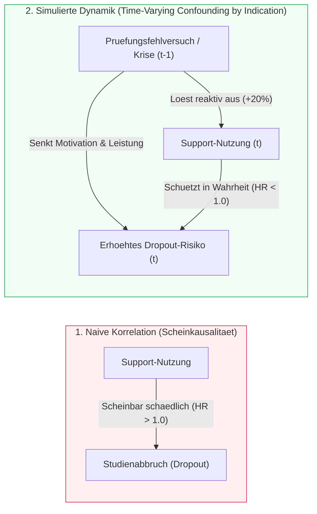
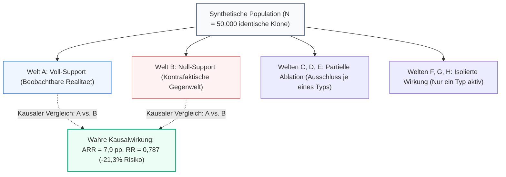
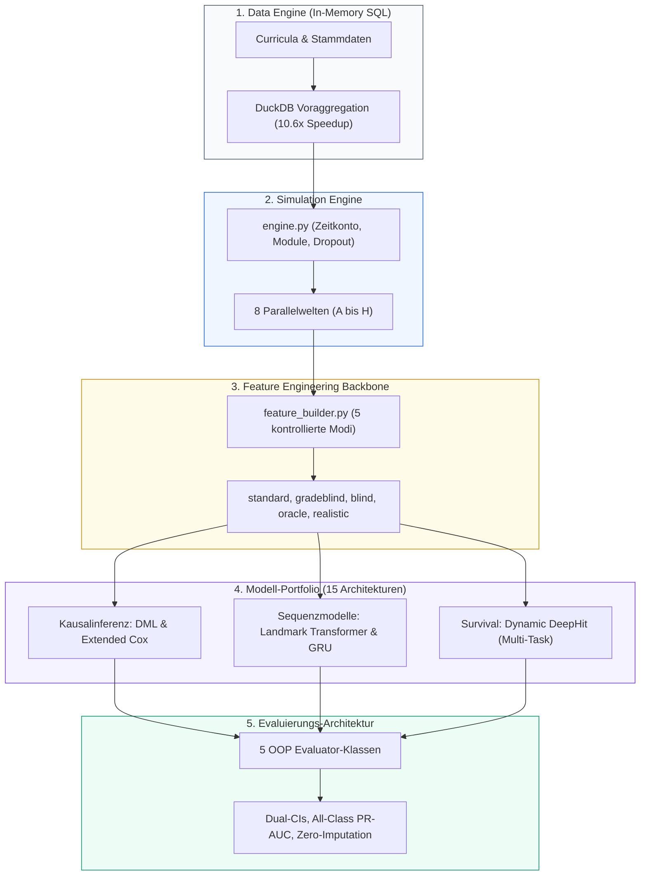

# DeepSupport: Kausale Evaluation von Bildungsinterventionen & Deep Survival Sequences

<p align="left">
  <a href="https://www.python.org/"></a>
  <a href="https://keras.io/"></a>
  <a href="docs/03_evaluations_and_benchmarks/pytorch_lxc_benchmark_evaluation_v42.md"></a>
  <a href="https://duckdb.org/"></a>
  <a href="docs/04_causal_and_simulation/"></a>
  <a href="docs/04_causal_and_simulation/04_Kausale_Vergleichsanalyse.md"></a>
  <a href="docs/03_evaluations_and_benchmarks/master_synopse_v4_gesamt.md"></a>
</p>

> **Hinweis zur KI-Transparenz:** Dieses Projekt wurde als transparentes Portfolio- und Forschungsprojekt in intensiver Paarprogrammierung mit modernen KI-Systemen (Antigravity IDE, Claude Opus/Sonnet 4.6 & 5.5, Gemini Pro 3.1, Flash 3.6/3.7/3.8, Gemini 4 Argon) entwickelt und lückenlos dokumentiert. Ausführliche Details siehe [Abschnitt Autorschaft & KI-Transparenz](#10-autorschaft--ki-transparenz).

---

## 1. Ursprung & Forschungsfrage

Dieses Projekt hat einen ganz konkreten, praktischen Ausgangspunkt: Zuletzt (bis Ende 2025) war ich selbst im Projekt **SoliD** an der **Hochschule Kaiserslautern (HSKL)** an der Konzeption und Durchführung eines hybriden Mathematik-Unterstützungsangebots beteiligt. Dabei drängte sich eine fundamentale Frage auf, die in der Hochschulpraxis überraschend selten methodisch sauber beantwortet werden kann:

> *„Bringen unsere Förderangebote eigentlich wirklich etwas – und wie lässt sich ihr kausaler Nutzen datengetrieben nachweisen, ohne in die klassischen statistischen Verzerrungsfallen zu tappen?“*

Im Bildungsbereich stehen Entscheidungsträger vor einem Dilemma: Reale Individualdaten von Studierenden sind aus guten Gründen (Datenschutz, institutionelle Silos zwischen Prüfungsamt und Lernmanagementsystemen) extrem restriktiv geschützt. Noch schwerwiegender ist jedoch das **methodische Problem**: Studierende wählen Fördermaßnahmen nicht zufällig aus. Wer sich in einer akuten Leistungskrise befindet, greift eher nach Hilfe. 

Das Projekt **DeepSupport** ist das Resultat einer hartnäckigen Auseinandersetzung mit dieser Fragestellung, um dieses Problem von Grund auf zu verstehen und methodisch zu untersuchen:
- **Phase 1 (Data Engineering):** Konzeption relationaler Datenmodelle in 3NF und eines ROLAP Star-Schemas zur Abbildung universitärer Studienverläufe.
- **Phase 2 (Data Analysis):** Entwicklung eines ersten dynamisch-stochastischen Studierendensimulators und Entdeckung des *Time-Varying Confounding*.
- **Phase 3 (Deep Learning):** Einsatz moderner Sequenzmodelle (Causal Transformers, Recurrent Neural Networks, Dynamic DeepHit) zur Vorhersage von Noten und Studienabbrüchen.
- **Phase 4 (Causal Benchmarking & V4.2):** Etablierung einer synthetischen Ground Truth über **acht parallele Welten**, Ausführung eines systematischen **Sensitivitätsgitters über 15 Szenarien ($N=50.000$, 225 trainierte DL-Modelle)** und datengetriebene Reflexion der Modellgrenzen.

*(Die vollständige chronologische Entwicklung ist im Dokument [DeepSupport Projektentwicklung](docs/08_project_evolution/DeepSupport_Projektentwicklung.md) dokumentiert.)*

---

## 2. Status Quo auf einen Blick (DeepSupport V4.2.5 / Simulator V5.0)

DeepSupport ist heute ein vollwertiges, modulares **Forschungs- und Evaluierungs-Framework**, das Methoden der Kausalinferenz, der klassischen Biostatistik (Survival-Analyse) und modernste Deep-Learning-Architekturen auf einer kontrollierten, synthetischen Simulationsbasis vergleicht:

1. **Synthetisches Multi-Universe-Testbed (DGP V4.1 & V5.0):** $N = 50.000$ Studierende werden über bis zu 16 Fachsemester mit individuellen Curricula, Prüfungsversuchen, Zeitkontomodell und Belastungsgrenzen simuliert (in **DGP V5.0** empirisch rekalibriert nach AMS/SELLMO, 22. DSW-Sozialerhebung und Destatis Fachserie 11; siehe [`config_audit_und_v5_roadmap.md`](docs/04_causal_and_simulation/config_audit_und_v5_roadmap.md)).
2. **Kausale Ground Truth Ebene (8 Parallelwelten):** Identische Studierende durchlaufen zeitgleich acht deterministisch synchronisierte Universen mit variierter Supportverfügbarkeit (Voll-Support, Null-Support, partielle und isolierte Angebote).
3. **Modell-Portfolio:** Vollständige Dual-Framework-Architektur in **TensorFlow/Keras 3** und **PyTorch 2.x / PyCox** – von klassischen Cox-Proportional-Hazards-Panels über Double Machine Learning (DML) bis hin zu Autoregressiven Deep Transformern (Pre-LayerNorm, FlashAttention) und Multi-Task Survival Netzen.
4. **Strikte Evaluierungsstandards & Unit-Tests:** Fünf typisierte, modulare Evaluator-Klassen mit Zero-Imputation-Policy im Metrik-Logging (`null` statt `0.0` bei nicht definierten Kennzahlen)[^1], Dual-Konfidenzintervallen (asymptotisch & Bootstrap), Precision-Recall-AUC für alle Klassen sowie **23 automatisierte Unit-Tests** (`tests/`).

---

## 3. Das methodische Problem: Das „Dropout-Paradoxon“ (im Simulator modelliert)

> [!IMPORTANT]
> **Simulations-Prämisse, Plausibilität & Grenzen realer Hochschuldaten:** Reale Hochschul-Verwaltungsdaten sind in der Regel nicht spezifisch genug, um einen solchen Selbstselektionseffekt empirisch trennscharf nachzuweisen; über die tatsächliche quantitative Stärke der Selbstselektion in der Realität lässt sich daher keine gesicherte Aussage treffen. Die Entscheidung, diesen Mechanismus als zentrale Strukturprämisse in den Simulator einzubauen, stützt sich vielmehr auf zwei Gründe: Erstens ist er **psychologisch und entscheidungsrational unmittelbar plausibel** (Hilfsangebote werden primär bei akutem Bedarf wie Fehlversuchen oder Überforderung aufgesucht), zweitens deckt er sich mit der **eigenen praktischen Beratungserfahrung (anekdotische Evidenz)**. Gerade weil die wahre Ausprägung im Feld verborgen bleibt, erlaubt die explizite Konstruktion im Simulator später im kontrollierten Experiment (durch simuliertes RCT in `S11`, Dosis-Variationen in `S02/S03` sowie KI-gestützte Budgetallokation) präzise zu prüfen, wie sich unterschiedliche Selektionsregime auswirken und welche kausalen Schätzer eine solche Verzerrung überhaupt auflösen können.

Wer derart strukturierte Verlaufsdaten naiv mit Standard-Verfahren des maschinellen Lernens auswertet, erlebt regelmäßig eine böse Überraschung: **Unadjustierte Modelle weisen für Support-Teilnehmer ein signifikant höheres Abbruchrisiko aus ($HR > 1{,}0$)!**



### Die medizinische Analogie: *Confounding by Indication*
In der Pharmakoepidemiologie ist dieses Phänomen als **Indikationsverzerrung** bestens bekannt:  
Untersucht man rein beobachtende Patientendaten, sterben Menschen, die Notfall-Herzmedikamente (z. B. Digitalis) einnehmen, signifikant häufiger an Herzinsuffizienz als Menschen ohne diese Medikation. Ein naiver Algorithmus würde schlussfolgern, das Medikament sei tödlich. In Wahrheit wird das Medikament jedoch selektiv genau jenen Patienten verabreicht, die sich bereits im schwersten Krankheitsstadium befinden.

Exakt diese Dynamik bildet der DeepSupport-Generator für Hochschulen nach: Freiwillige Förderangebote sind als **krisengetriebene Intervention** modelliert. Studierende suchen Tutorien im Simulator vor allem dann auf, wenn sie eine Klausur im Erstversuch nicht bestanden haben ($+20\,\text{pp}$ Aufnahmewahrscheinlichkeit) oder die Motivation sinkt. Statische Modelle verwechseln die Indikation (die Krise) mit der Wirkung der Förderung.

---

## 4. Das 8-Parallelwelten-Design als synthetische Ground Truth

In realen Beobachtungsdaten ist das *Fundamental Problem of Causal Inference* unlösbar: Wir können denselben Studierenden im selben Semester nicht gleichzeitig mit und ohne Support beobachten. 

Im Rahmen von Judea Pearls *Structural Causal Models* (SCM) nutzt DeepSupport die synthetische Simulation, um eine **kontrollierte Ground-Truth-Ebene** einzuziehen. Für jeden einzelnen Studierenden wird derselbe Basis-Zufalls-Seed verwendet, sodass exakt identische Personen in acht Parallelwelten existieren:



### Methodische Designentscheidung: RNG-Stream-Synchronisation
Um den kausalen Effekt isoliert messbar zu machen, ist das Prüfungsrauschen in allen Welten deterministisch an das Tripel `(Student, Modul, Versuch)` gekoppelt. Die Rauschrichtung bleibt identisch; nur der Behandlungsmechanismus unterscheidet die Universen. 
*Hinweis zur methodischen Grenze:* Diese Synchronisation ist eine bewusste Designentscheidung. Ein stochastischer „Schmetterlingseffekt“ (z. B. verändertes Schlafverhalten bei Supportnutzung) würde die Kontrafakten leicht verschieben – die gewählte Variante maximiert jedoch die interne Validität für das Algorithmen-Benchmarking.

### Die wahre Kausalität im Datensatz (Ground Truth, $N=50.000$):
- **Gesamteffekt (A vs. B):** Der Support senkt die Studienabbruchquote von **37,10 % auf 29,20 %**.  
  $\implies$ **Absolute Risikoreduktion ($ARR$): $7{,}90\,\text{pp}$** | **Relatives Risiko ($RR$): $0{,}787$ ($-21{,}3\,\%$)**
- **Verweildauer bei Abbruch:** Support verlängert nicht das Scheitern, sondern **verkürzt die Verweildauer von Abbrechern** um ein halbes Semester ($4{,}48$ vs. $4{,}94$ Semester) – falsche Studienentscheidungen werden schneller korrigiert.

---

## 5. System- & Software-Architektur

Das Framework wurde im V4-Refactoring als modulares, typisiertes Python-Package [`deepsupport`](src/deepsupport/) realisiert:



### Kernkomponenten:
- **`data_engine/`:** DuckDB-Integration zur spaltenbasierten SQL-Aggregation von Millionen Prüfungsdatensätzen. Vollständiges relationales 11-Tabellen-ERD, Curriculumsstruktur und DGP-Dekonstruktion siehe [`datenarchitektur_und_eda_v4.md`](docs/04_causal_and_simulation/datenarchitektur_und_eda_v4.md).
- **`features/feature_builder.py`:** Zentraler Feature-Backbone, der Data-Leakage verhindert (z. B. strikt zeitverzögerte CP-Stände) und 5 standardisierte Feature-Räume generiert.
- **`evaluation/metrics_logger.py`:** Standardisiertes OOP-Logging über 5 Klassen (`SurvivalEvaluator`, `RegressionEvaluator`, `MulticlassEvaluator`, `CausalEvaluator`, `DualHeadEvaluator`).

---

## 6. Wichtigste Erkenntnisse im relativen Modellvergleich

> [!NOTE]
> **Epistemische Einordnung:** Die absoluten Kennzahlen ($R^2$, ROC-AUC) spiegeln die Gesetzmäßigkeiten des synthetischen Generators wider. Der wissenschaftliche Erkenntnisgewinn liegt im **relativen Vergleich der Methoden**, da alle Architekturen auf exakt derselben Datenbasis konkurrieren.  
> **Vollständige Side-by-Side-Gegenüberstellung aller >25 Modelle (alle 6 Modellfamilien, Pre- vs. Post-Refactor V4.2.5, Keras 3 vs. PyTorch 2.x):** **[`modell_gegenueberstellung_gesamt_v425.md`](docs/03_evaluations_and_benchmarks/modell_gegenueberstellung_gesamt_v425.md)**.

### A. Kausale Inferenz: Unified Ground-Truth Benchmark & KI-Policy-Targeting


*(Vollständiger Benchmark-Report: [`causal_ground_truth_benchmark.md`](docs/03_evaluations_and_benchmarks/causal_ground_truth_benchmark.md) | Gesamt-Modellvergleich: [`modell_gegenueberstellung_gesamt_v425.md`](docs/03_evaluations_and_benchmarks/modell_gegenueberstellung_gesamt_v425.md) | Visuelle Exploration: [`visuelle_datenexploration_v4.md`](docs/04_causal_and_simulation/visuelle_datenexploration_v4.md))*

| Schätzer / Ground-Truth-Referenz (`S01_baseline`, $N=50.000$) | Modus | Fachlich | Überfachlich | Psychosozial | Einordnung |
| :--- | :---: | :---: | :---: | :---: | :--- |
| **GT 1: Population Knockout RR** (Welt A vs. C/D/E) | *Kontrafaktisch* | **0.9087** (+2.93 pp) | **0.9210** (+2.50 pp) | **0.9458** (+1.67 pp) | Kohorten-Effekt bei Wegfall einer Säule (A vs. B: **RR = 0.7858**, **+7.95 pp**) |
| **GT 3: Subgruppen-ATT Interval-HR** | *Kontrafaktisch* | **0.8465** (RR 0.8535) | **0.8054** (RR 0.8193) | **0.7874** (RR 0.7970) | Wahrer Schutzeffekt auf den tatsächlichen Support-Nutzern in Welt A |
| **1. Naiver Unadjustierter Vergleich** | `standard` | 1.4788 | 1.5346 | 0.8776 | Massives *Confounding by Indication* durch den 2./3.-Versuchs-Trigger |
| **2. Extended Cox (`PHReg`, `strata=t_stop`)** | `standard` / `oracle` | **0.9587** / **0.9581** | **0.9906** / **0.9881** | **0.9770** / **0.9685** | Nach Behebung der Float64-Auslöschung konsistent $\text{HR} < 1{,}0$ auf allen 3 Säulen |
| **3. MSM / IPTW** (`cloglog` Gepooltes Hazard) | `standard` / `oracle` | **0.9374** / **0.9235** | **0.9001** / **0.8890** | **0.8926** / **0.8715** | Stabilisierte Propensity-Gewichte mit multinomialem Cluster-Bootstrap ($\text{HR}_{\text{all}}=0{,}9170$) |
| **4. Double ML** (Multivariate Robinson, 5-Fold) | `standard` / `oracle` | **0.8952** / **0.9135** | **0.9711** / **0.9410** | **0.9737** / **0.9642** | Gemeinsame Orthogonalisierung aller 3 Säulen rekonstruiert GT auf $\pm 0{,}025$ |
| **5. G-Computation** (Step-Standardized & Rollout) | `standard` / `oracle` | **0.9501** / **0.9621** | **0.9182** / **0.9208** | **0.9129** / **0.9417** | 1-Step $\text{RR}_{\text{all}}=0{,}8603 / 0{,}8787$, 16-Sem.-Rollout $\text{RR}=\mathbf{0{,}7611}$ |

- **KI-Policy-Targeting unter 20 % Budgetrestriktion ($N_{\text{test}} = 7.196$):**  
  Wenn nur für **20 % der Kohorte** Förderplätze verfügbar sind, erzielt eine **Zufalls-Allokation (Lotterie)** lediglich $+1{,}60\,\text{pp}$ ARR (19,9 % des Voll-Support-Effekts, $\text{NNT} = 12{,}5$). Eine **reaktive Verwaltungsregel** (HZB + Erwerbsstunden) steigert den Effekt auf $+3{,}10\,\text{pp}$ ($\text{NNT} = 6{,}5$, Lift $1{,}94\times$). **Kausales CATE/Uplift-Scoring (`standard`, nach Semester 2)** realisiert mit nur 20 % Budget bereits **$+3{,}36\,\text{pp}$ Kohorten-ARR (41,9 % des 100%-Effekts)**, halbiert die Number Needed to Treat auf **$\text{NNT} = 5{,}9$** und verdoppelt die Fördereffizienz (**$2{,}11\times$ Lift vs. Zufall**).

### B. Operative Früherkennung: Deep Learning & Landmark-Attention
- **Landmark-Prognose nach 2 Semestern (Hurdle Stage 2):** Bereits nach zwei absolvierten Semestern erklären Regressoren auf den tatsächlichen Absolventen (`graduates_only=True`) **$77{,}5\,\%$ der Varianz der späteren Abschlussnote ohne Einzelnoten (`gradeblind`)** bzw. **$87{,}1\,\%$ mit S1–S2-Noten (`standard`)**; der hybride 32-D-Exam-Transformer-Embedding-Klassifikator erreicht bei der 4-Klassen-Statusprognose **$79{,}6\,\%$ Accuracy** ($\text{OVR ROC-AUC} = 0{,}8500$).
- **Precision-Recall Lift bei seltenen Events & Klausur-Durchfallprognose:** Auf Prüfungsebene erreichen `Exam GRU` und `CausalExamTransformer` einen **$9{,}3\times–11{,}9\times$ PR-AUC Lift** bei akuten Dropout-Ereignissen ($\text{ROC-AUC} = 0{,}8976$), während die $1/K_i$-gewichteten **Dual-Head Next-Exam Autoregressoren** Nichtbestehen ($\pi_0 = 16{,}4\,\%$) mit **`Fail PR-AUC = 0,7779`** ($4{,}75\times$ Lift, $\text{Pass ROC-AUC} = 0{,}9409$, Note $R^2 = 0{,}7050$) prognostizieren.

### C. Sensitivitätsgitter über 15 Szenarien ($N=50.000$, 225 DL-Modelle)
Die systematische Variation von Supportdosis, Rauschlevel, Zeitkosten und Überlastungsstrafen ([`master_synopse_v4_gesamt.md`](docs/03_evaluations_and_benchmarks/master_synopse_v4_gesamt.md)) belegt eine bemerkenswerte **ARR-Stabilität zwischen $7{,}3$ und $8{,}5\,\text{pp}$** – der kausale Schutzeffekt bricht selbst unter widrigen Rahmenbedingungen nicht zusammen.

---

## 7. Wissenschaftliche Praxis & Datengetriebene Reflexion

Ein zentrales Merkmal dieses Projekts ist die Verpflichtung zu transparenter wissenschaftlicher Praxis: Hypothesen werden nicht post-hoc gerechtfertigt, sondern am Datengenerator überprüft und bei Bedarf verworfen:

- **Prüfung der Apathie-Hypothese (Szenario S16) & Grenzen des Semester-1-Tests:**  
  Ursprünglich wurde vermutet, die verhaltensbasierte Apathie-Dämpfung bei stark entmutigten Studierenden ($\text{Motivation} < 0{,}20$ bzw. $\text{Soziale Integration} < 0{,}20$) sei die Hauptursache für die unterschiedlichen Entzerrungsprofile zwischen V3.6 und V4.1. Ein Deaktivierungslauf ($N=20.000$, identischer Seed) zeigte im Selektionsbias von **Semester 1** einen Nettoeffekt von exakt $0{,}0000$ und über den gesamten Studienverlauf lediglich $0{,}22\,\text{pp}$. Die strukturelle Code-Analyse zeigte jedoch auch, *warum* ein Semester-1-Test diese Hypothese in V4.1 gar nicht greifen konnte: Durch die stark komprimierte Startverteilung in V4.1 ($\kappa=20{,}0$) startet in Semester 1 praktisch niemand unterhalb der Apathieschwelle von $0{,}20$ ($P(\text{Mot}_0 < 0{,}20) < 10^{-5}$); die Schwelle wird erst in höheren Semestern ($t \ge 3$) nach kumulierten Prüfungsfehlversuchen ($-0{,}05$ pro Fehlversuch) erreicht. Ein aussagekräftiger Test des Apathie-Mechanismus erfordert daher die isolierte Betrachtung höherer Krisensemester bzw. die breitere V5-Motivationsvarianz ($\kappa=9{,}0$).
- **Aufdeckung des selektiven Motivations-Varianzkollapses:**  
  Eine systematische Verteilungsanalyse aller Merkmale ($N=50.000$) deckte auf, dass bei der Umstellung auf Beta-Verteilungen in V4.1 die Varianz der Motivation unbemerkt um $50\,\%$ kollabiert war ($\kappa=20{,}0$), während HZB-Note und Alter perfekt repliziert wurden.
- **Roadmap für Version 5:**  
  Die gewonnenen Erkenntnisse wurden in einen empirischen Kalibrierungsplan überführt: Rekalibrierung der Motivation auf $\kappa=9{,}0$ ($\sigma \approx 0{,}15$) gestützt auf psychometrische Normdaten (Academic Motivation Scale AMS), Zero-Inflated Erwerbsmodellierung nach der 22. DSW-Sozialerhebung und Destatis-Geschlechtermatrizen ([`config_audit_und_v5_roadmap.md`](docs/04_causal_and_simulation/config_audit_und_v5_roadmap.md)).

---

## 8. Themen-Gateways zur Wissensbasis

Die vollständige Dokumentation umfasst über 60 Fachdokumente. Für den gezielten Einstieg sind die Themen in fünf Gateways strukturiert:

| Gateway | Themenschwerpunkt | Zentrale Dokumente |
|:---|:---|:---|
| **DGP & Kausalität** | Simulationsarchitektur, 8 Universen, Bias-Analysen, Survival-Mathematik, V5-Spezifikation | [`causal_ground_truth_benchmark.md`](docs/03_evaluations_and_benchmarks/causal_ground_truth_benchmark.md)<br>[`datenarchitektur_und_eda_v4.md`](docs/04_causal_and_simulation/datenarchitektur_und_eda_v4.md)<br>[`grundlagen_survival_analyse_und_zensierung.md`](docs/04_causal_and_simulation/grundlagen_survival_analyse_und_zensierung.md)<br>[`visuelle_datenexploration_v4.md`](docs/04_causal_and_simulation/visuelle_datenexploration_v4.md)<br>[`04_Kausale_Vergleichsanalyse.md`](docs/04_causal_and_simulation/04_Kausale_Vergleichsanalyse.md)<br>[`config_audit_und_v5_roadmap.md`](docs/04_causal_and_simulation/config_audit_und_v5_roadmap.md)<br>[`systematische_verteilungsanalyse_v36_vs_v41.md`](docs/04_causal_and_simulation/systematische_verteilungsanalyse_v36_vs_v41.md) |
| **Deep Learning** | Autoregressive Transformer, Causal Masking, Dynamic DeepHit, Vollvergleich aller >25 Modelle | **[`modell_gegenueberstellung_gesamt_v425.md`](docs/03_evaluations_and_benchmarks/modell_gegenueberstellung_gesamt_v425.md)**<br>[`model_architectures.md`](docs/02_architectures_and_models/model_architectures.md)<br>[`synopse_heavy_suite_s01_s07_s08.md`](docs/03_evaluations_and_benchmarks/synopse_heavy_suite_s01_s07_s08.md) |
| **Benchmarks** | V4.2.5 Post-Refactor Gesamt-Benchmark (>25 Modelle), Master-Synopse S01–S15, Kausaler Benchmark | **[`modell_gegenueberstellung_gesamt_v425.md`](docs/03_evaluations_and_benchmarks/modell_gegenueberstellung_gesamt_v425.md)**<br>[`master_synopse_v4_gesamt.md`](docs/03_evaluations_and_benchmarks/master_synopse_v4_gesamt.md)<br>[`causal_ground_truth_benchmark.md`](docs/03_evaluations_and_benchmarks/causal_ground_truth_benchmark.md)<br>[`pytorch_lxc_benchmark_evaluation_v42.md`](docs/03_evaluations_and_benchmarks/pytorch_lxc_benchmark_evaluation_v42.md)<br>[`synopse_supportwirkung_s01_s02_s03.md`](docs/03_evaluations_and_benchmarks/synopse_supportwirkung_s01_s02_s03.md) |
| **Engineering** | DuckDB In-Memory SQL, 5 Feature-Modi, 5 OOP-Evaluatoren | [`feature_builder_map.md`](docs/02_architectures_and_models/feature_builder_map.md)<br>[`duckdb_architecture_analysis.md`](docs/02_architectures_and_models/duckdb_architecture_analysis.md)<br>[`refactoring_plan_evaluation_pipeline1.md`](docs/01_master_plans/refactoring_plan_evaluation_pipeline1.md) |
| **Evolution** | Chronologische Entwicklungsreise, DE/DA/DL-Submodule, Kritik | [`DeepSupport_Projektentwicklung.md`](docs/08_project_evolution/DeepSupport_Projektentwicklung.md)<br>[`DeepSupport_Kritische_Bewertung.md`](docs/08_project_evolution/DeepSupport_Kritische_Bewertung.md) |

*Das vollständige, detaillierte Dokumentenverzeichnis befindet sich im [Dokumentations-Index (`docs/README.md`)](docs/README.md).*

---

## 9. Quickstart & Reproduzierbarkeit

### Voraussetzungen
- **OS:** Windows 10/11 oder Linux (Debian/Ubuntu)
- **Python:** 3.12 (empfohlen im dedizierten Virtual Environment)
- **Wichtig für Windows:** Aufgrund von Sicherheitsrichtlinien für native DLLs (HiGHS-Solver / SciPy) stets das whitelisted venv verwenden.

### Installation
```powershell
# A) Vollständiges Repository klonen (inkl. LFS-Rohdaten):
git clone https://github.com/mAInbrAIn-wk/DeepHSSurvial.git

# B) Leichtgewichtiges Klonen (nur Code, Metriken & Dokumentation ohne ~20 GB LFS-CSVs):
$env:GIT_LFS_SKIP_SMUDGE = "1"
git clone https://github.com/mAInbrAIn-wk/DeepHSSurvial.git
cd DeepHSSurvial

# Virtuelle Umgebung aktivieren (Beispiel Windows PowerShell)
$env:PYTHONPATH = "src"
C:\GitHub_public\.venv\Scripts\Activate.ps1
```

### Ausführen von Unit-Tests, Benchmarks & Training
```powershell
# 1. Automatisierte Unit-Test-Suite (23 Tests: DGP-V5-Simulator, Survival-Losses, Kausalschätzer, Splits & Evaluatoren)
$env:PYTHONPATH = "src"
C:\GitHub_public\.venv\Scripts\python.exe -m unittest discover -s tests -v

# 2. Vollständiger Post-Refactor Master-Benchmark (V4.2.5: Alle 6 Modellfamilien, >25 Architekturen)
$env:PYTHONPATH = "src"
C:\GitHub_public\.venv\Scripts\python.exe src/deepsupport/runners/run_post_refactor_benchmark_s01.py --phase all

# 3. Vereinheitlichter Kausaler Ground-Truth Benchmark & KI-Policy-Targeting Showcase
$env:PYTHONPATH = "src"
C:\GitHub_public\.venv\Scripts\python.exe src/deepsupport/evaluation/causal_ground_truth_benchmark.py

# 4. Schneller Rauchtest der Evaluator-Pipeline
C:\GitHub_public\.venv\Scripts\python.exe src/deepsupport/runners/run_smoke_test_evaluators.py

# 5. PyTorch & PyCox Turnkey Runner (LXC-Container / Multi-Threading)
python3 src/run_torch_lxc.py --include_ar --include_seq

# 6. Vollständiger Overnight-Runner auf V4.1-Daten
C:\GitHub_public\.venv\Scripts\python.exe src/run_overnight_v41.py
```

---

## 10. Autorschaft & KI-Transparenz

Dieses Projekt wurde von **Wilfried Keller** konzipiert, geleitet und iterativ weiterentwickelt.

### Transparente Arbeitsweise im KI-Zeitalter
Die Umsetzung erfolgte in intensiver, dokumentierter Paarprogrammierung mit modernen generativen KI-Systemen. Sämtliche Designentscheidungen, Architektur-Iterationen, Fehlversuche und Korrekturen wurden als unverfälschte Protokolle archiviert:
- **Konversationsprotokolle:** Über 300 Iterationsschritte sind im Ordner [`docs/07_conversation_logs/`](docs/07_conversation_logs/) chronologisch einsehbar.
- **Rollenverteilung:** Die konzeptionelle Steuerung, Fragestellung, Methodenwahl und kritische Prüfung lag beim menschlichen Autor; die Codegenerierung, das Refactoring, das Erstellen repetitiver Benchmark-Skripte und die formale Doku-Pflege wurden durch KI-Agenten assistiert.

---

[^1]: **Abgrenzung von Metrik-Logging (Zero-Imputation) und Noten-Vorverarbeitung:** Die *Zero-Imputation-Policy* in [`metrics_logger.py`](src/deepsupport/evaluation/metrics_logger.py) bezieht sich auf das JSON-Reporting (nicht berechnete oder auf eine Modellklasse nicht anwendbare Metriken wie `c_index` bei reinen Klassifikatoren werden strikt als `null`/`None` statt `0.0` protokolliert). Auf der **Feature- und Target-Ebene** in [`feature_builder.py`](src/deepsupport/data_engine/feature_builder.py) gilt hingegen eine differenzierte Domänenlogik: (a) Nicht bestandene **Einzelprüfungen** in den Sequenzhistorien (`note_clean`) erhalten die reale Fehlversuchsnote **`5.0`** (während lediglich vor der allerersten Klausur in Semester 1 ein neutraler Prior von `3.0` für den verzögerten `gpa_prev` genutzt wird). (b) Bei der **Abschlussnoten-Regression** (`target='abschlussnote'`) haben Studienabbrecher naturgemäß keine Abschlussnote (`NaN`). Um keine künstliche Punktmasse bei `5.0` oder `3.0` in die stetige Regression einzuführen, folgt das Framework hier einer **zweistufigen Hurdle-Architektur**: Stufe 1 (Survival / Competing Risks / 4-Klassen-Status) modelliert die Abschluss- vs. Abbruchwahrscheinlichkeit auf der Gesamtkohorte, während Stufe 2 (`graduates_only=True`) die erwartete Abschlussnote $\mathbb{E}[Y \mid \text{Abschluss}]$ bedingt auf erfolgreiche Absolventen schätzt.

